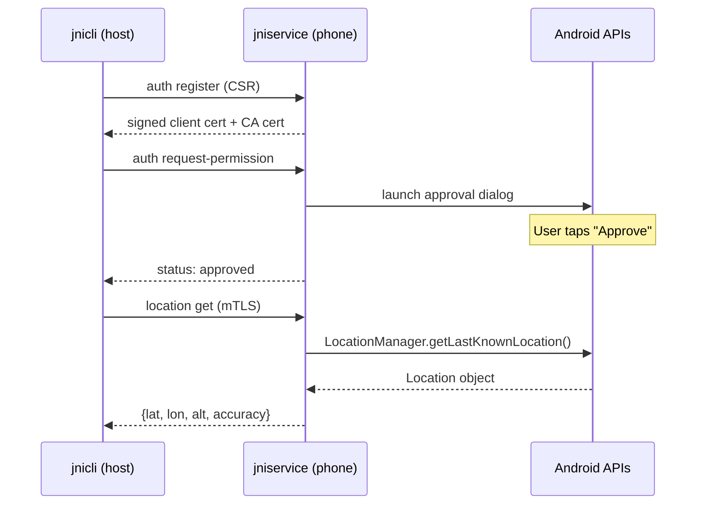
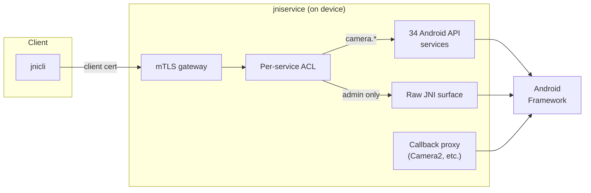

# jni-proxy

gRPC proxy layer for [AndroidGoLab/jni](https://github.com/AndroidGoLab/jni).

Exposes Android JNI bindings over gRPC so that a host machine can control an
Android device remotely. Includes `jniservice` (the on-device gRPC server),
`jnicli` (the command-line client), and `jniserviceadmin` (ACL management).

## Components

- **cmd/jnicli** -- CLI client that talks to jniservice over gRPC
- **cmd/jniservice** -- gRPC server that runs on the Android device (APK or Magisk module)
- **cmd/jniserviceadmin** -- Admin CLI for ACL management
- **grpc/** -- gRPC server and client wrappers (34 services)
- **proto/** -- Protobuf service definitions (64 packages)
- **handlestore/** -- Object handle mapping for cross-process JNI references
- **tools/cmd/protogen** -- Generates .proto files from Java API specs
- **tools/cmd/grpcgen** -- Generates gRPC server/client Go wrappers
- **tools/cmd/cligen** -- Generates jnicli cobra commands
- **tools/cmd/callbackgen** -- Generates Java callback adapter classes

## gRPC Remote Access

The gRPC layer turns any Android phone into a remotely accessible API server. A companion service (`jniservice`) runs on the device -- either as an APK (non-rooted) or a Magisk module (rooted, auto-starts on boot). Clients on any machine connect over the network using `jnicli`.



Each client registers with a unique certificate (mTLS). Method access is controlled by per-service ACLs -- the device owner approves which services each client can use through an on-screen dialog:



**Available services** include camera, location, bluetooth, WiFi, telephony, battery, power, alarm, vibrator, audio, NFC, notifications, and more (34 registered services, 4000+ RPCs across 64 proto packages). Callback-based APIs (like Camera2) work through a bidirectional streaming proxy with build-time generated adapter classes.

## Running jniservice on Android

jniservice is a gRPC server that exposes the JNI surface and Android APIs over the network.

### Rooted devices (Magisk module)

Auto-starts on boot.

```bash
make magisk DIST_GOARCH=arm64                          # build module
adb push build/jniservice-magisk-arm64-v8a.zip /sdcard/
adb shell su -c "magisk --install-module /sdcard/jniservice-magisk-arm64-v8a.zip"
adb reboot                                             # starts on next boot
```

Configuration (optional): create `/data/adb/modules/jniservice/jniservice.env`:

```bash
JNISERVICE_PORT=50051
# Use this device's current Wi-Fi address.
JNISERVICE_LISTEN=192.168.1.20
```

In Magisk app-process mode, the launcher passes the selected file path to
`app_process` as `JNISERVICE_CONFIG`; it is parsed as `KEY=VALUE` data, not
sourced as shell code. For APK mode, the selected durable file is staged as
`jniservice.env` at the package-private path described below. Nonempty listener
environment overrides are rebuilt separately in `jniservice.launch.env` on
every launch; an empty file clears prior transient overrides without changing
the durable file. The APK resolves defaults, durable file, staged launch file,
then nonempty process environment values. `app_process` resolves defaults,
selected file, then its nonempty process environment. Only
`JNISERVICE_LISTEN` and `JNISERVICE_PORT` are read from these files;
`JNISERVICE_DATA_DIR` remains environment-only. The default is
`127.0.0.1:50051`; unspecified addresses such as `0.0.0.0` and `::` are
rejected. Bind to the phone's current Wi-Fi IPv4 address for direct-LAN access.
The listener reads its settings when the app process starts.

### Non-rooted devices (APK)

Auto-starts after the first unlock following boot via a foreground service.

```bash
make apk DIST_GOARCH=arm64          # build APK
adb install build/jniservice-arm64-v8a.apk
```

Open "jniservice" from the launcher once to start the service and register the boot receiver.

The APK reads `jniservice.env` from
`/data/data/center.dx.jni.jniservice/files/jniservice/jniservice.env`. A
registered, already-approved `jnicli` identity with permission to use the raw
JNI API can write this private file through the existing authenticated API:
use `java.io.FileWriter` for the path above and write the `KEY=VALUE` lines.
That operation needs permission for the raw JNI `FindClass`, `NewStringUTF`,
`GetMethodID`, `NewObject`, and `CallMethod` RPCs.
The raw JNI calls use the normal mTLS identity and service ACL; `jniserviceadmin`
continues to manage permissions, and no separate listener-settings RPC is
provided. After editing the file, restart the app process so the native
listener reloads it; restarting only the foreground service in an already
running process does not reload the native library. For example:

```bash
adb shell am force-stop center.dx.jni.jniservice
adb shell am start -n center.dx.jni.jniservice/.JNIServiceActivity
```

A missing optional file leaves the defaults in effect, while a malformed or
unreadable file prevents startup rather than silently binding somewhere else.

The optional [phone-local fixed-performance startup action](docs/fixed-performance-startup.md)
can re-enable fixed-performance mode after unlock and connection to trusted Wi-Fi,
using a dedicated paired wireless-ADB identity. It is disabled until configured.

### Connecting

`jnicli` keeps client credentials in `~/.jnicli` by default. Use `--profile NAME`
for separate devices; this loads `~/.jnicli/NAME/{client.crt,client.key,ca.crt}`.
The `localhost:50051` examples below require jniservice to listen on loopback
(the default); if `JNISERVICE_LISTEN` is set to the phone's Wi-Fi IPv4 address,
phone-local calls must use that address too.
Phone-local invocation example (run `jnicli` on the phone); hosts should use the
phone-IP direct-LAN example below:

```bash
jnicli --profile pixel8pro --addr localhost:50051 auth list-permissions
```

`auth register --profile NAME --insecure --cn NAME` writes the three files to
that profile when the output flags are omitted. Explicit `--cert`, `--key`, and
`--ca` paths always override the defaults.

For direct-LAN access, dial the phone's current Wi-Fi address and configured
port while verifying the server certificate for `jniservice`:

```bash
jnicli --profile pixel8pro --addr 192.168.0.242:50051 \
  --authority jniservice camera photo --index 0 --output photo.jpg
```

Replace the address and port with the values configured on the phone. This
uses the profile's mTLS credentials and keeps TLS certificate verification
enabled; do not add `--insecure`.

Phone-local invocation example (run this on the device); hosts should use the
phone-IP direct-LAN example above:

```bash
jnicli --addr localhost:50051 --insecure jni get-version
```

For headless JPEG capture, including AE warm-up, flash, ISO, and exposure
controls, see [camera photo controls](docs/camera-photo.md).

## E2E Test Verification

Run `make test-emulator` to test against a connected device or emulator. Tests skip when `JNICTL_E2E_ADDR` is not set.

<details>
<summary>Verified platforms (click to expand)</summary>

| Type     | Device              | Android | API | ABI       | Build           | Date       | Passed | Total |
| -------- | ------------------- | ------- | --- | --------- | --------------- | ---------- | ------ | ----- |
| Phone    | Pixel 8a            | 16      | 36  | arm64-v8a | BP4A.260205.001 | 2026-03-22 | 65     | 65    |
| Emulator | sdk_gphone64_x86_64 | 15      | 35  | x86_64    |                 | 2026-03-14 | 21     | 21    |

</details>

## Quick Start

```bash
# Build the CLI for Linux
make dist-jnicli-linux

# Run E2E tests
make test-emulator
```

## Code Generation

All proto definitions, gRPC wrappers, and CLI commands are generated from Java API specs in the [jni](https://github.com/AndroidGoLab/jni) repo. To regenerate everything:

```bash
make generate   # runs: proto → protoc → grpc → cli
```

Individual steps:

```bash
make proto      # generate .proto files from Java specs
make protoc     # compile .proto → Go stubs
make grpc       # generate gRPC server/client wrappers
make cli        # generate jnicli cobra commands
make callbacks  # generate Java callback adapter classes
```

## Security

> **Security disclaimer:** This is a hobby/research project. The mTLS + ACL system provides basic access control, but it has not been audited and should not be relied upon for security-critical deployments. The self-signed CA, handle-based object references, and raw JNI surface all have inherent attack surface. Use it on trusted networks for development, testing, and experimentation.

## Dependencies

This module depends on [github.com/AndroidGoLab/jni](https://github.com/AndroidGoLab/jni) for core JNI bindings and code generation tools.
When developing locally, use a `go.work` file pointing to both repos.
